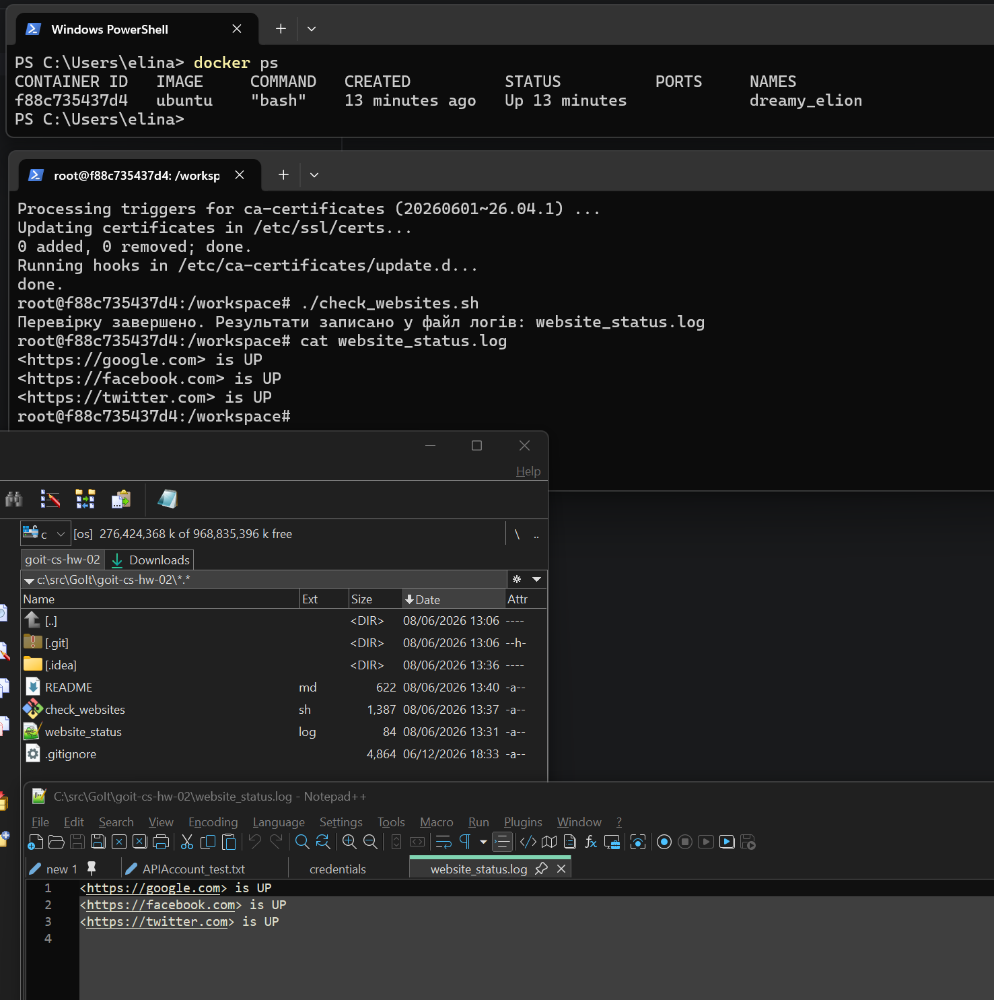
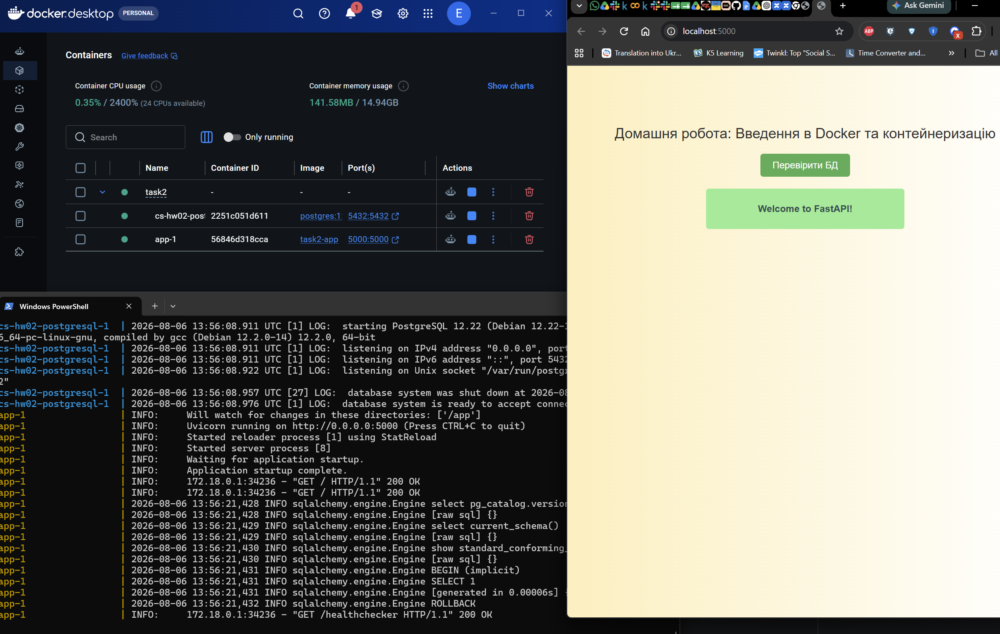

# Домашнє завдання до модуля “Основи операційних систем”
https://www.edu.goit.global/uk/learn/48407490/19336208/21190481/homework

## Завдання 1

To run `check_websites.sh` on local UBUNTU in Docker (on WINDOWS) execute these commands in WINDOWS Powershell

1. run bash on ubuntu with mounted dir from windows:    `docker run -it -v C:\src\GoIt\goit-cs-hw-02:/workspace ubuntu bash`
2. giv exec permission on the script:                   `chmod +x check_websites.sh`
3. install curl in container:                           `apt-get update && apt-get install -y curl`
4. run the script:                                      `./check_websites.sh`
5. review the log file:                                 `cat check_websites.log`

## Завдання 2

Результат:

